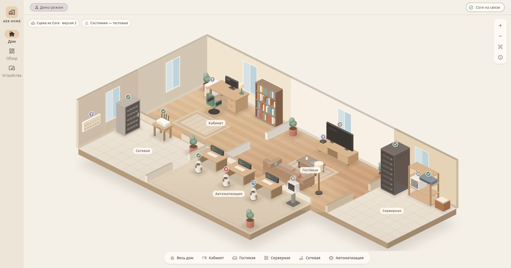
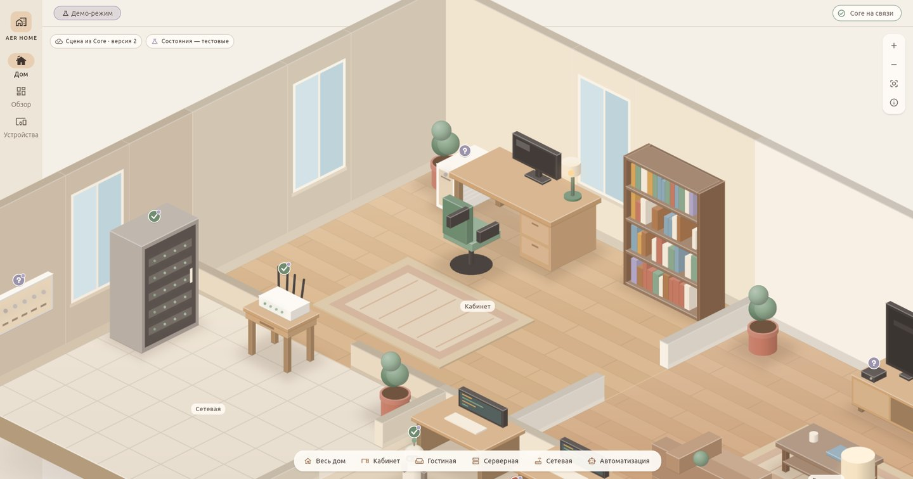
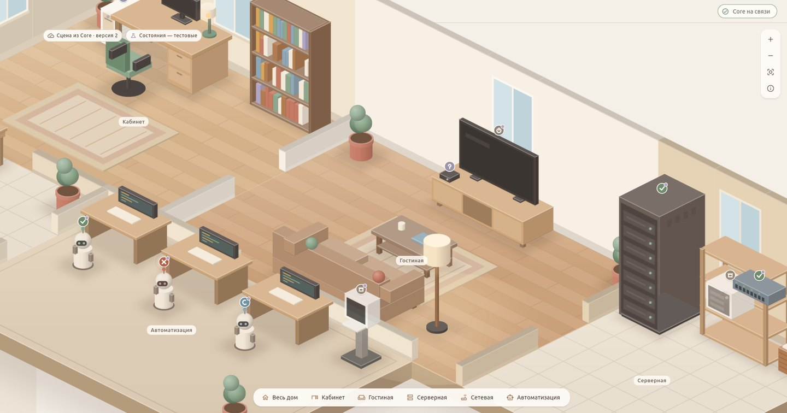
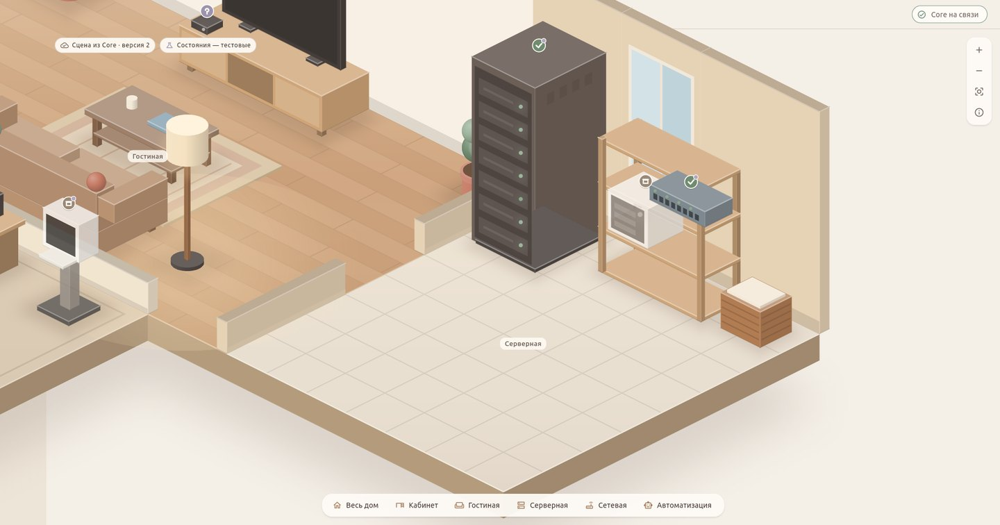
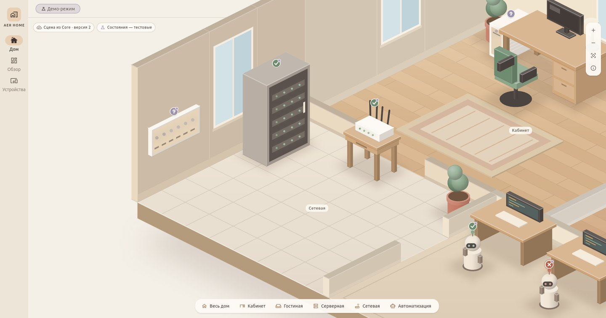
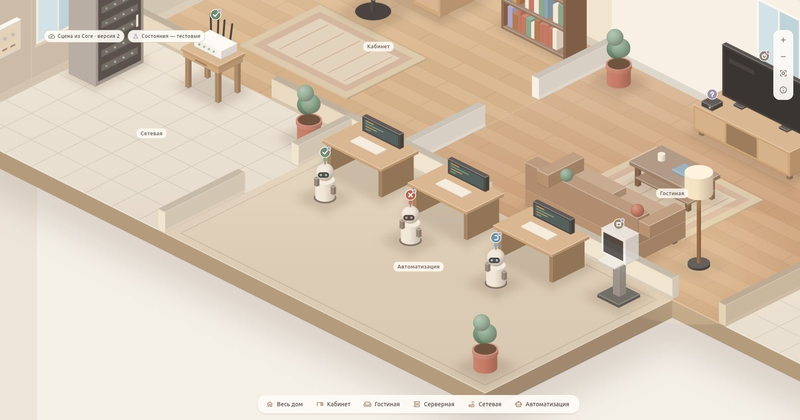
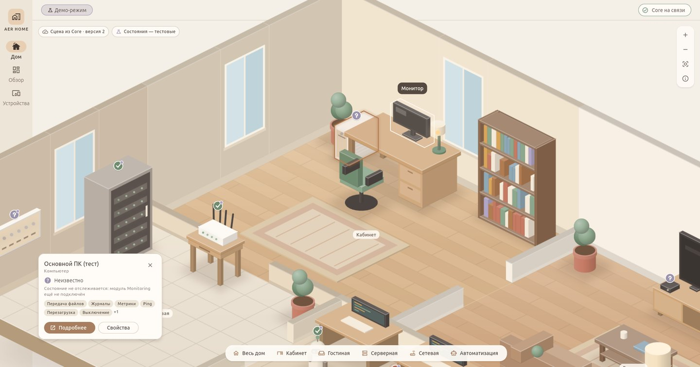
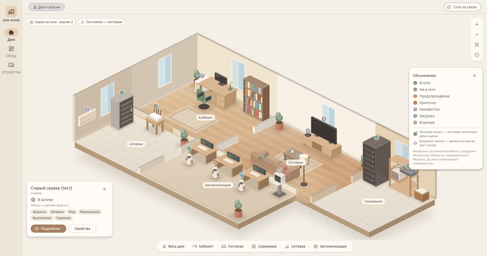

<div align="center">

# 🏡 AER HOME

**мой маленький цифровой дом**

*тёплый, бежевый, свой*

<br>



<br>
<br>


</div>

<br>

Здесь живёт всё, что гудит, светится и думает у меня дома — только не в виде таблиц, а как настоящий дом. Можно заглянуть в каждую комнату, подойти к любому устройству и спросить, как у него дела.

Никаких серверных стоек в холодном свете. Только дерево, плед, растения в горшках и тихо мигающие огоньки.

<br>

## 🛋️ Комнаты

<table>
  <tr>
    <td width="50%"></td>
    <td width="50%"></td>
  </tr>
  <tr>
    <td align="center"><b>Кабинет</b><br><sub>стол, лампа, книги и главный компьютер</sub></td>
    <td align="center"><b>Гостиная</b><br><sub>диван, торшер и телевизор для кино</sub></td>
  </tr>
  <tr>
    <td width="50%"></td>
    <td width="50%"></td>
  </tr>
  <tr>
    <td align="center"><b>Серверная</b><br><sub>домашняя, не дата-центр</sub></td>
    <td align="center"><b>Сетевая</b><br><sub>роутер и огоньки связи</sub></td>
  </tr>
  <tr>
    <td colspan="2"></td>
  </tr>
  <tr>
    <td colspan="2" align="center"><b>Автоматизация</b><br><sub>маленькие боты за своими рабочими столами</sub></td>
  </tr>
</table>

<br>

## ✨ Как это ощущается

<table>
  <tr>
    <td width="50%"></td>
    <td width="50%"></td>
  </tr>
  <tr>
    <td align="center"><sub>навёл — подсказка, нажал — карточка</sub></td>
    <td align="center"><sub>значки состояний, которые не нужно расшифровывать</sub></td>
  </tr>
</table>

- 🖱️ колесо — ближе и дальше, перетаскивание — прогулка по дому
- 🚪 одна кнопка — и камера мягко перелетает в нужную комнату
- 🌙 если связь пропала, дом всё равно на месте и честно говорит, что данные устарели
- 🧸 есть и обычный, «взрослый» вид — списки и карточки, когда не до прогулок

<br>

## 🌱 Как растёт дом

```
  ✔  фундамент        дом умеет жить и помнить
  ✔  реестр           у каждой вещи есть имя и место
  ✔  дом              комнаты, мебель, огоньки
  ✔  редактор         двигать мебель и строить комнаты
  ✔  самочувствие     настоящие состояния устройств
  ·  боты             присмотр за помощниками
  ·  связь            дотянуться до дома откуда угодно
```

<br>

<div align="center">
<sub>сделано для себя · с любовью к бежевому · 2026</sub>
</div>

## Поддерживаемые платформы

Android, Windows, Linux/Ubuntu Desktop и Ubuntu Server. Нативный iOS (M11) окончательно CANCELLED / OUT OF SCOPE по решению владельца 2026-10-28; существующие материалы сохраняются. Возможный веб-интерфейс для iPhone — только необязательная будущая идея без нового этапа.

## Windows

Нативный Windows Desktop (M10): сборка, переносимый пакет, пользовательская установка, трей и уведомления — [инструкция](docs/WINDOWS.md), [проверки и ограничения](docs/M10_WINDOWS_REPORT.md). Core запускается отдельно. Встроенный Remote Viewer проверен через локальный Gateway/RDP-стенд; управляемый Windows Host и отдельный AER Connect относятся к M14.4.

M14.4: [AER Connect](docs/AER_CONNECT.md) реализован и собран с пользовательским установщиком, в том же визуальном стиле AER HOME. [Windows Host](docs/WINDOWS_HOST.md) через FreeRDP server/shadow и DXGI/SendInput прошёл ограниченную живую приёмку Windows 11 Pro с отдельным согласием: изображение через собственный loopback Gateway, ввод только в тестовом окне, отзыв и видимый Stop. Полная матрица Home/clipboard/secure desktop/реальной сети ещё UNVERIFIED; этап **IN_PROGRESS**. [Результаты и актуальный пакет](docs/M14_4_REPORT.md), [исправление CRT/FFI](docs/CRT_FFI_REPORT.md).
